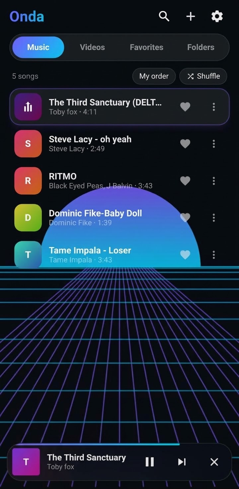
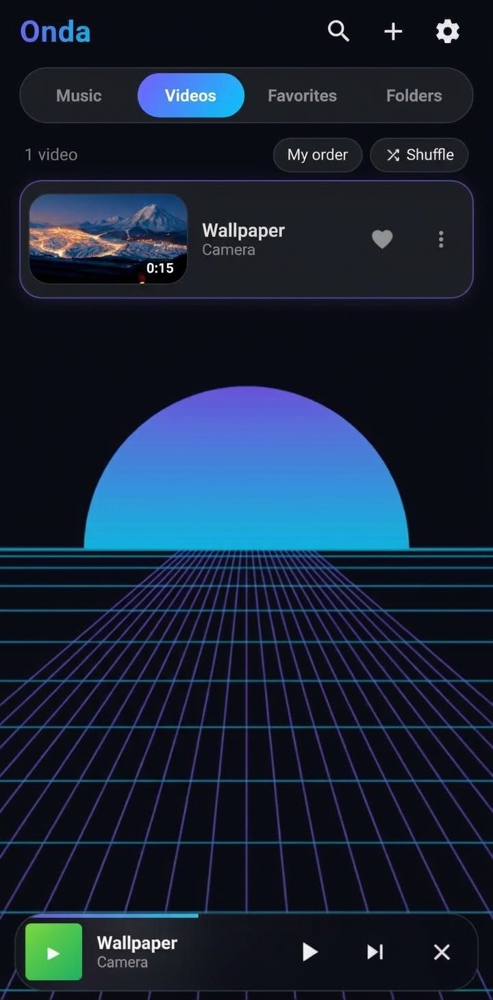
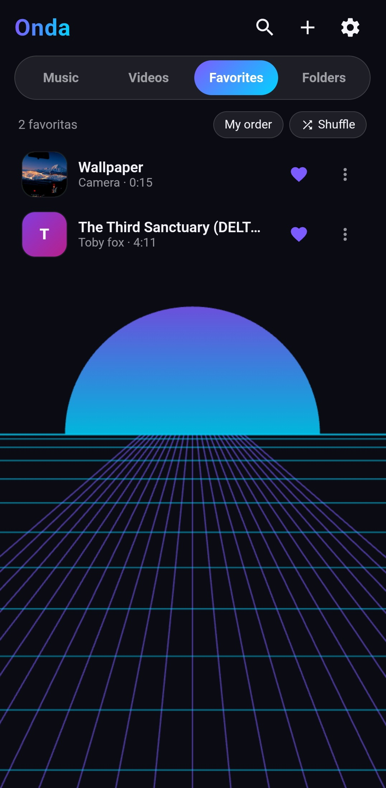
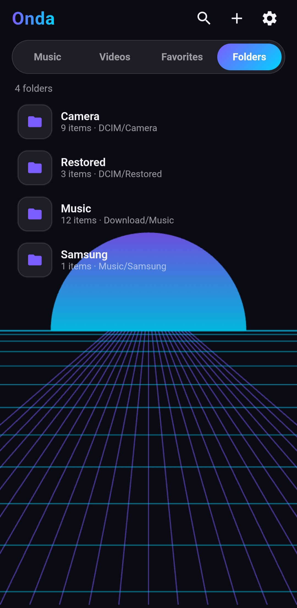
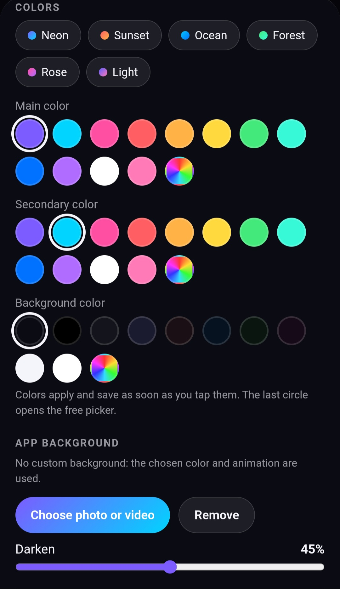

# 🎵 Onda Player — Free, Open-Source Music Player for Android

Onda Player is a lightweight, free, and open-source Android music player designed to provide a smooth, private, and ad-free listening experience. Enjoy your favorite local audio files with a clean, intuitive interface and no unnecessary distractions.

✨ Features

- 🚫 Ad-Free Experience: Listen to your music without advertisements or commercial interruptions.
- ⚡ Lightweight and Fast: Designed for efficient performance and resource usage.
- 🔒 Privacy-Focused: No account registration required. Data collection practices depend on the application's actual implementation.
- 🎧 Background Playback: Listen to music while using other applications or with your screen turned off.
- 🎨 Modern Interface: Simple navigation with dark and light theme support.
- 📁 Multiple Audio Formats: Support for formats such as MP3, WAV, FLAC, AAC, and OGG, depending on the implemented playback libraries.
- 🆓 Free and Open Source: The source code is publicly available for anyone to inspect, learn from, modify, and redistribute under the terms of the MIT License.

- 📸 Screenshots

  
  
  
  
  

📲 Installation

1. Open the "Releases" (../../releases) section of this repository.
2. Download the latest APK available.
3. Open the downloaded APK on your Android device.
4. If Android requests permission to install apps from that source, allow it in your device settings.
5. Complete the installation and launch Onda Player.

Security note: Only install APK files from sources you trust. Android may display a warning when installing an APK outside Google Play. Verify the source and integrity of the file before proceeding.

🛠️ Tech Stack

- Platform: Android
- Languages: Java and/or Kotlin, depending on the source modules
- Build System: Gradle
- Development Environment: Android SDK

🔐 Privacy and Security

Onda Player aims to provide a privacy-conscious listening experience.

- No account registration is required.
- The application should request only the permissions necessary for its functionality.
- Any claims about analytics, tracking, network access, or personal data collection should be verified against the actual source code.

🤝 Contributing

Contributions, bug reports, and suggestions are welcome!

1. Fork this repository.
2. Create a branch for your changes.
3. Make and test your changes.
4. Submit a pull request describing your improvements.

Please ensure that your contributions comply with the project's license and applicable third-party licenses.

🤖 Development Note

AI-assisted development tools were used during the development of this project.

📄 License

Onda Player is licensed under the MIT License.

You are free to use, copy, modify, merge, publish, distribute, sublicense, and/or sell copies of the software, subject to the conditions of the MIT License.

See the ""LICENSE"" (LICENSE) file for the complete license text.

Third-party components: Dependencies, libraries, and other third-party assets may be subject to their own licenses.

---

Made with 🎵 for music lovers.
